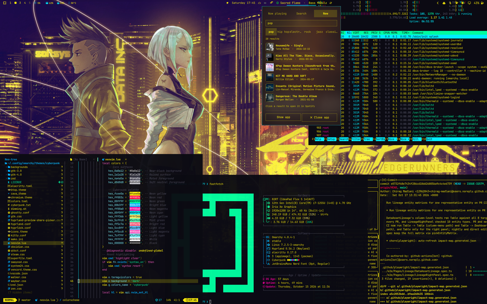

```
 █████   ██   ██  ██████   ███████  ██████   ██████   ██   ██  ██   ██  ██   ██
██   ██  ██   ██  ██   ██  ██       ██   ██  ██   ██  ██   ██  ███  ██  ██  ██ 
██        █████   ██████   █████    ██████   ██████   ██   ██  ███  ██  █████  
██         ███    ██   ██  ██       ██ ██    ██       ██   ██  ██ █ ██  ██ ██  
██   ██    ███    ██   ██  ██       ██  ██   ██       ██   ██  ██  ███  ██  ██ 
 █████     ███    ██████   ███████  ██   ██  ██        █████   ██   ██  ██   ██
```

> Inspired by Dizziee.

Cyberpunk was created specifically for the **OMARCHY** | Hyprland system.</br>
*..."of the upper air," "heavenly," or "celestial."*

# Cyberpunk Omarchy Theme

A custom Omarchy theme inspired by *Cyberpunk: Edgerunners*. It uses a near-black background with neon yellow text and cyan, magenta, red, and green accents.



## Features

- Dark desktop colors with neon accents
- Matching colors for supported apps, including terminals and Neovim
- Designed for Omarchy and Hyprland

# Installation
This theme can be installed two ways to your Omarchy system. Choose one.

### TERMINAL
```bash
omarchy-theme-install https://github.com/Adam-loy/Cyberpunk
```

### WALKER MENU
1. Copy this link: `https://github.com/Adam-loy/Cyberpunk`
2. Open Walker, `SUPER+ALT+SPACE`, navigate to: Install < Style < Theme
3. Paste: `CTRL+SHIFT+V`, then press enter/return.

## Wallpapers

The repository includes a curated selection of high-resolution wallpapers. Because large image files increase the repository size, they can make cloning, downloading, and pushing take longer.

To install from a ZIP archive, download and extract the repository, then move the `cyberpunk` folder into:

```text
~/.config/omarchy/themes/
```

To add your own wallpapers after installing or cloning the theme, copy them into:
```
~/.config/omarchy/themes/cyberpunk/backgrounds/
```
